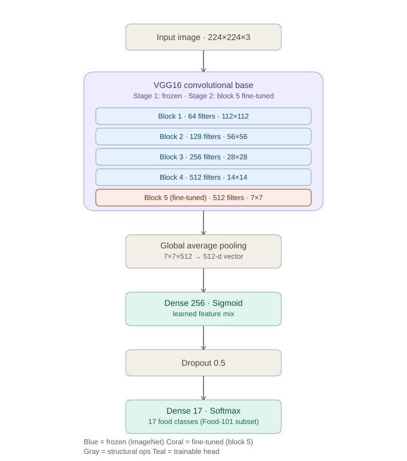

# VGG16 Food Classifier

Transfer-learning food classifier built on VGG16, as a learning project before a larger application.

## Architecture

<picture>
  <source media="(prefers-color-scheme: dark)" srcset="docs/architecture-dark.svg">
  <source media="(prefers-color-scheme: light)" srcset="docs/architecture-light.svg">
  
</picture>

VGG16 convolutional base (ImageNet-pretrained) -> custom head:

- Blocks 1-4: frozen
- Block 5: fine-tuned in stage 2
- GlobalAveragePooling2D
- Dense(256, sigmoid)
- Dropout(0.5)
- Dense(17, softmax) — classes limited to `config.SELECTED_CLASSES` for faster iteration

Trained on a 17-class subset of the [Food-101](https://www.tensorflow.org/datasets/catalog/food101) dataset.

## Results

Proper 3-way split: 90% of `train` for gradient updates, 10% held back from
`train` for early stopping / checkpoint selection, and the full `validation`
split kept untouched until the very end.

| Set | Accuracy |
|---|---|
| Train | 98.1% |
| Validation (early stopping) | 77.9% |
| **Test (held out, never touched during training)** | **82%** |

Best-performing classes: pizza, bibimbap, hamburger, beignets. Weakest:
apple_pie, bread_pudding, bruschetta — mostly confused with other
baked goods / tomato-topped dishes, visible in the confusion matrix
generated by `src.evaluate`.

## Technologies used

- **Python** — project language
- **TensorFlow / Keras** — model, training loop, data pipeline (`tf.data`)
- **VGG16** — pretrained ImageNet backbone, transfer learning + fine-tuning
- **TensorFlow Datasets** — Food-101 loading
- **NumPy** — array/image preprocessing
- **scikit-learn** — evaluation metrics (classification report, confusion matrix)
- **Streamlit** — interactive web app for uploading and classifying images
- **Pillow (PIL)** — image I/O for the app

## Usage

```bash
pip install -r requirements.txt
python -m src.train       # two-stage training
python -m src.evaluate    # test-set metrics
python -m src.predict path/to/image.jpg
streamlit run app.py      # interactive web app
```
